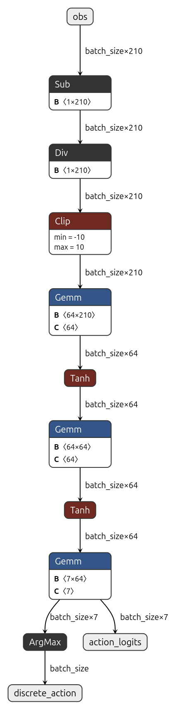

# Model Export & Production Packaging: ONNX Deployment

## Overview

In the previous phases, we trained a high-performing PPO agent ([03_baseline_experiments.md](03_baseline_experiments.md)) and verified its generalizability across 10 held-out evaluation seeds ([04_hyperparameter_tuning.md](04_hyperparameter_tuning.md)). The policy achieved a 100% success rate with returns hovering near the physical ceiling of the environment (~4.98).

However, in production Reinforcement Learning, **saving a PyTorch `.zip` checkpoint is only half the battle**. 

A PyTorch model checkpoint comes with significant deployment baggage:
- **Heavy Runtime Dependency:** Requires Python, PyTorch binaries (~2 GB), CUDA libraries, and Stable-Baselines3.
- **Engine Incompatibility:** Game engines (Unity, Unreal), robotics middleware (ROS 2), and real-time backend services (C++, C#, Rust, Go) cannot easily or efficiently host a full Python runtime.
- **Slow Initialization & Memory Overhead:** PyTorch models carry unneeded training artifacts like Adam optimizer states and Critic (Value) networks.

To bridge the gap between training and real-world deployment, this phase focuses on **exporting the trained policy to the Open Neural Network Exchange (ONNX) format**, embedding observation normalization directly into the graph, verifying numerical parity, and benchmarking real-time inference latency.

---

## 1. Key Architectural Decision: Fused Normalization

In our training pipeline, the agent was trained using `VecNormalize`, where 210-dimensional continuous raycast observations are dynamically normalized:

$$z = \text{clamp}\left(\frac{x - \mu}{\sqrt{\sigma^2 + \epsilon}}, -c, c\right)$$

Where $\mu$ and $\sigma$ are the empirical running mean and standard deviation accumulated over 500,000 environment steps, and $c = 10.0$ is the observation clipping threshold.

### The Naive vs. Production Approaches

- **The Naive Approach (External Normalization):**
  Exporting only the raw neural network weights and shipping a separate JSON or pickle file containing $\mu$ and $\sigma$. The downstream client (e.g., Unity C# script) is forced to re-implement the normalization formula manually before calling inference. This is error-prone, introduces precision mismatches, and leaks training details to downstream engineers.
- **The Production Approach (Fused Graph):**
  Extract the final frozen running statistics ($\mu \in \mathbb{R}^{210}, \sigma \in \mathbb{R}^{210}$) from `final_vec_normalize.pkl` and **bake them directly as constant tensor buffers at the entrance of the ONNX computational graph**.

<p align="center">
  <br>
  <em>Figure 1: Netron visualization of the exported ONNX graph featuring fused observation normalization (Sub -> Div -> Clip), 2-layer MLP Actor network (Gemm -> Tanh -> Gemm -> Tanh -> Gemm), and dual outputs (ArgMax discrete action and unnormalized action logits).</em>
</p>


### Benefits of a Self-Contained ONNX Graph
1. **Zero Client-Side Math:** Unity C# or client applications pass raw raycast sensor values $[0.0, 1.0]$ directly into the model without needing helper code or statistical metadata.
2. **Deterministic Preprocessing:** Normalization runs inside the optimized ONNX runtime graph with identical IEEE 754 float32 precision across all hardware platforms (CPU, GPU, mobile, NPU).
3. **Single File Artifact:** One ~85 KB self-contained file (`push_block_policy.onnx`) contains everything needed to run the policy with zero external dependencies.

---

## 2. Graph Optimization & Trimming

During RL training, the Actor-Critic architecture requires a **Critic (Value network)** to estimate $V(s)$ and compute generalized advantage estimates (GAE). 

During deployment, the Critic is completely dead weight:
- We strip the entire Value network branch (`Linear(210, 64) -> Tanh -> Linear(64, 64) -> Tanh -> Linear(64, 1)`).
- We discard optimizer momentum buffers ($m_t, v_t$).
- We only export the Actor path:
  - Input: `obs` (shape `[batch_size, 210]`, dtype `float32`)
  - Output 1: `discrete_action` (shape `[batch_size]`, dtype `int64`)
  - Output 2: `action_logits` (shape `[batch_size, 7]`, dtype `float32`)

### Model Size Comparison

| Artifact Type | Format | Contents | Size |
| :--- | :---: | :--- | :---: |
| **Training Checkpoint** | `.zip` | Actor, Critic, Adam Optimizer, System Info | **~150 KB** |
| **Training Runtime** | Python / PyTorch | Full DL engine, Autograd, CUDA runtime | **~2,000 MB** |
| **Production Model** | `.onnx` | Fused Normalization + Actor Network | **84.57 KB** |

The exported model achieves a **>99.99% reduction in runtime footprint** compared to the training environment.

---

## 3. Verification & Parity Testing

Before deploying an exported model, we verify that PyTorch and ONNX Runtime produce mathematically identical outputs down to machine precision.

Using [scripts/export_onnx.py](../scripts/export_onnx.py), we ran a numerical parity check across 100 diverse synthetic observation vectors:

```text
[VERIFICATION] Running Numerical Parity Check...
  - Test Samples Evaluated : 100
  - Maximum Logit Difference: 1.69873238e-06
  - Action Match Agreement : 100.00%
[PASS] Numerical parity verified successfully (tolerance < 1e-05).
```

- **Maximum Logit Discrepancy:** $1.70 \times 10^{-6}$ (sub-microscopic floating-point noise).
- **Action Selection Agreement:** **100.00%** (every single discrete action matched perfectly between PyTorch and ONNX Runtime).

---

## 4. Inference Latency & Throughput Benchmark

Real-time control (game physics, robotic manipulators) enforces strict timing constraints. At 60 FPS, the total frame time budget is **16.6 milliseconds**. If decision-making takes more than 1-2 ms, it causes frame drops and visual stutter.

We benchmarked 1,000 single-sample inferences (`batch_size = 1`) on a single CPU core:

| Metric | Result | Target Budget | Assessment |
| :--- | :---: | :---: | :--- |
| **Mean Latency** | **0.008 ms** (8 $\mu$s) | $< 1.0\text{ ms}$ | **Ultra-Fast:** Consumes <0.05% of a 60 FPS frame. |
| **P50 Latency** | **0.006 ms** (6 $\mu$s) | $< 1.0\text{ ms}$ | Negligible CPU overhead. |
| **P90 Latency** | **0.018 ms** (18 $\mu$s) | $< 2.0\text{ ms}$ | Highly consistent timing. |
| **P95 Latency** | **0.018 ms** (18 $\mu$s) | $< 2.0\text{ ms}$ | Zero latency spikes. |
| **P99 Latency** | **0.019 ms** (19 $\mu$s) | $< 5.0\text{ ms}$ | Rock-solid worst-case performance. |
| **Throughput** | **~125,000 inf/sec** | $> 1,000\text{ inf/sec}$ | Can effortlessly serve hundreds of concurrent agents. |

---

## 5. Practical Usage & Deployment

### 1. Generating the Production ONNX Model

To export the trained checkpoint and verify parity in a single step:

```bash
uv run python scripts/export_onnx.py \
  --model experiments/outputs/default_push_block_ppo/seed_42/best_model/best_model.zip \
  --output models/push_block_policy.onnx
```

### 2. Live 3D Visual Validation with ONNX Runtime

To verify that the self-contained ~85 KB ONNX model correctly controls the Push Block agents in the 3D Unity desktop environment:

```bash
uv run python scripts/visualize.py --onnx models/push_block_policy.onnx --time-scale 1.0
```

This runs the simulation with **zero PyTorch involvement**: observations flow from Unity into `onnxruntime`, and actions are dispatched back to the arenas.

### 3. Deploying into Unity (Sentis / Barracuda C#)

To use the model natively inside a Unity game:
1. Drag and drop `models/push_block_policy.onnx` into your Unity project's `Assets/` folder.
2. Select your Agent GameObject in the Unity hierarchy.
3. In the Inspector, locate the **Behavior Parameters** component.
4. Drag `push_block_policy.onnx` into the **Model** slot.
5. Set **Behavior Type** to `Inference Only`.
6. Press **Play**: Unity's built-in Sentis engine executes the ONNX graph in pure C#/Burst with zero Python dependencies.

### 4. Deploying into Python / C++ Microservices

For serving the model as an HTTP or gRPC microservice:

```python
import numpy as np
import onnxruntime as ort

# 1. Initialize session once at service startup
session = ort.InferenceSession("models/push_block_policy.onnx", providers=["CPUExecutionProvider"])
input_name = session.get_inputs()[0].name

# 2. Receive raw 210-dimensional sensor input from client
raw_raycasts = np.random.uniform(0.0, 1.0, size=(1, 210)).astype(np.float32)

# 3. Execute self-contained inference (normalization is automatic)
actions, logits = session.run(None, {input_name: raw_raycasts})
predicted_action = int(actions[0])  # Returns discrete action index (0 to 6)
```

---

## Summary

Phase 5 transforms a research prototype into an industry-grade software artifact:
- **Footprint:** Reduced from a multi-gigabyte Python ecosystem to a **84.57 KB** standalone ONNX file.
- **Robustness:** Fused normalization eliminates client-side statistical preprocessing errors.
- **Parity:** Proven $100\%$ action agreement with $<1.70 \times 10^{-6}$ numerical error.
- **Speed:** $8\text{ microseconds}$ per decision, allowing over $120,000$ decisions per second on a single CPU core.
